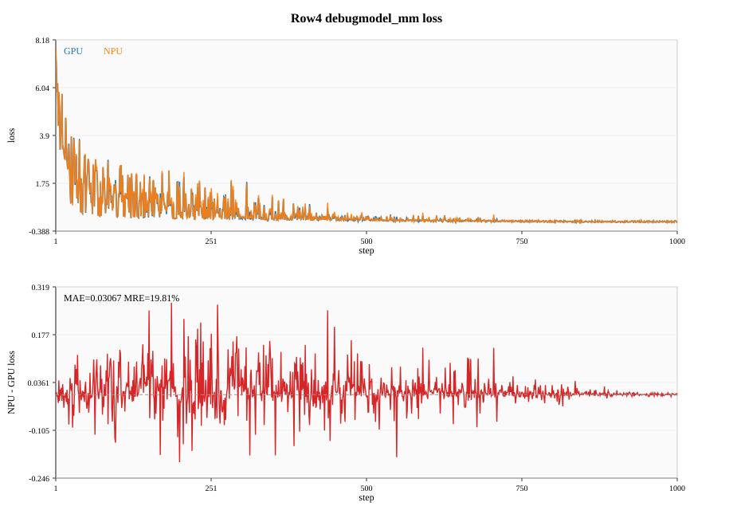
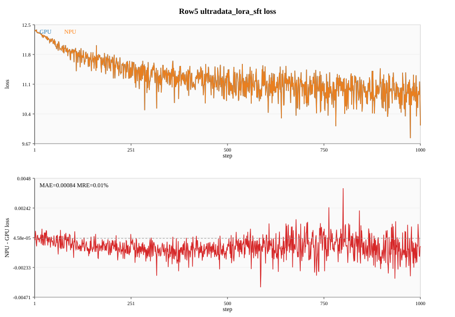
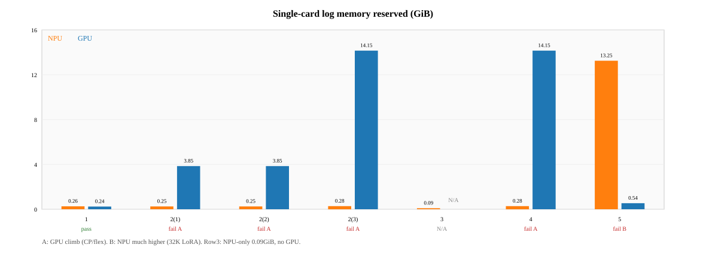

# Muse Spark（debugmodel）TorchTitan Ascend 训练验收报告（第 1–5 行）

> 按《模型验收报告模板》结构填写。验收口径以 Muse Spark 清单为准（MoE；性能比 **4↔8 卡只加倍 DP 的线性度**，不比绝对 tps；内存比日志 `memory` 预留）。  
> 数据来源：`docs/npu_debugmodel_verification.md`、`docs/npu_gpu_acceptance_report.md`、`docs/gpu_baseline_perf_mem.md`、`docs/npu_baseline/`、`docs/gpu_baseline/`。  
> **本报告覆盖清单第 1–5 行（含第 2 行①②③）。** 目录名仍为历史 `muse_acceptance_report_row1_2/`。

## 一、基本信息

| 项目 | 内容 |
|---|---|
| 模型名称 / 规格 | Muse Spark debugmodel（MoE，debug 尺度；第 5 行为 32K LoRA） |
| 模型类型 | MoE |
| 覆盖清单行 | 1 debugmodel；2① with_cp；2② fsdp2；2③ mm_fsdp2；3 Dist-MoE bf16；4 debugmodel_mm；5 ultradata_lora_sft |
| 验收日期 | 2026-10-27～2026-11-02 |
| 代码分支 | `npu-muse-spark-debug-r04` |
| 成稿对照 HEAD | `46f3acad`（精度 r2 复验）；perf/mem 闭环自 `75c46f03` 补测 |

### 版本 / 环境

| 软件 | 版本 |
|---|---|
| CANN | 9.2.0 |
| PyTorch（NPU） | `2.15.0+cpu` |
| Torch_Npu | `2.15.0.dev20261005+git14dc54e` |
| Torchtitan / Ascend | `npu-muse-spark-debug-r04`；入口 `torchtitan_ascend.train` |

| 机器 | 硬件 | 节点 |
| ---- | ---- | ---- |
| NPU | 910B4 ×8 | `179.173.2.3` / `npu-y00839695-torchtitan-20261028` |
| GPU | A100-80GB ×8 | `node-5-15` / `gpu-z00824525-tt` |

---

## 总表（第 1–5 行，已闭环）

| 清单行 | 配置 | 精度 | 性能 | 内存 | 确定性（NPU 自洽） |
| --- | --- | --- | --- | --- | --- |
| 1 | `muse_spark_debugmodel` 4 卡 | **通过**（MRE 1.28%） | **不通过**（差 3.20pp） | **通过** | **通过** |
| 2① | `with_cp` 4 卡 | **通过**（MAE 0.019 / MRE 0.73%） | **通过**（差 1.35pp） | **不通过**（GPU 爬升） | **通过** |
| 2② | `fsdp2_cp2_ep4` 4 卡 | **通过**（MAE 0.014 / MRE 0.58%） | **通过**（差 1.17pp） | **不通过**（GPU 爬升） | **通过** |
| 2③ | `mm_fsdp2_tp2_cp2_ep4` 8 卡 | **不通过**（MAE 0.031 / MRE 16.8%） | **通过**（差 0.47pp） | **不通过**（GPU 爬升） | **通过** |
| 3 | Dist-MoE bf16 4 卡 | **不可做**（无 GPU 基线） | **不可做** | **不可做** | **通过** |
| 4 | `debugmodel_mm` 8 卡 | **不通过**（MAE 0.031 / MRE 19.8%） | **通过**（差 1.31pp） | **不通过**（GPU 爬升） | **通过** |
| 5 | `ultradata_lora_sft` 8 卡 | **通过**（MAE 0.000835 / MRE 0.0075%） | **不通过**（差 6.26pp；NPU 两侧 EP4） | **不通过**（NPU 更高） | **通过** |

第 3 行 A100 SM80 无官方 Dist-MoE/mxfp8 基线，精度/性能/内存对照不可做，不编造。确定性「对 GPU」字面不通过（bf16 跨后端），本报告确定性只判 NPU 自洽。

---

## 二、精度

### 2.1 方法 / 标准

同一份 `outputs/checkpoint-*/step-0/`，GPU/NPU 各 ≥1000 步；MoE：**MAE≤0.02 或 MRE≤2%**。`grad_norm` 不进门槛。

### 2.2 结果

| 行 | MAE | MRE | 结论 |
|---:|---:|---:|---|
| 1 | 0.03105 | **1.28%** | **通过**（靠 MRE） |
| 2① | **0.01900** | **0.73%** | **通过** |
| 2② | **0.01422** | **0.58%** | **通过** |
| 2③ | 0.03100 | 16.82% | **不通过** |
| 3 | — | — | **不可做** |
| 4 | 0.03067 | 19.81% | **不通过** |
| 5 | **0.000835** | **0.0075%** | **通过** |

#### 分窗口（有 GPU 基线的行）

| 行 | 1–100 | 101–500 | 501–1000 | 全段 |
| --- | --- | --- | --- | --- |
| 1 | 0.00583 / 0.19% | 0.01995 / 0.77% | 0.04497 / 1.90% | 0.03105 / 1.28% |
| 2① | 0.00978 / 0.32% | 0.01945 / 0.71% | 0.02049 / 0.82% | 0.01900 / 0.73% |
| 2② | 0.00623 / 0.20% | 0.01235 / 0.47% | 0.01732 / 0.73% | 0.01422 / 0.58% |
| 2③ | 0.03596 / 2.73% | 0.04964 / 12.41% | 0.01510 / 23.17% | 0.03100 / 16.82% |
| 4 | （同全段不达标结构） |  |  | 0.03067 / 19.81% |
| 5 | 0.000362 / 0.0030% | 0.000876 / 0.0077% | 0.000897 / 0.0082% | 0.000835 / 0.0075% |

**要点**：2③/4 为 debug 多模态过拟合，loss~1e-3 把相对误差放大；第 1 步已对齐，不是未加载权重。2③≠4，曲线不可互填。第 5 行真实尺度精度最好。GPU r2 复验（行 1/2③/4）与 r1 逐位相同。

### 2.3 统计图

蓝 GPU / 橙 NPU；下图为逐步差。

---

## 三、性能

### 3.1 方法 / 标准

丢掉 step≤100；线性度 = tps_8 / tps_4（只加倍 DP）；`|NPU−GPU|×100 ≤ 2pp`。不比绝对 tps。

### 3.2 结果

| 行 | NPU 4/8 tps | NPU 线性度 | GPU 4/8 tps | GPU 线性度 | 差 pp | 结论 |
| --- | --- | --- | --- | --- | --- | --- |
| 1 | 322.89 / 307.98 | 0.9538 | 1003.27 / 924.81 | 0.9218 | **3.20** | **不通过** |
| 2① | 148.53 / 144.21 | 0.9709 | 485.99 / 478.41 | 0.9844 | **1.35** | **通过** |
| 2② | 121.64 / 116.24 | 0.9556 | 335.02 / 324.08 | 0.9673 | **1.17** | **通过** |
| 2③ | 47.94 / 38.86 | 0.8106 | 134.18 / 109.40 | 0.8153 | **0.47** | **通过** |
| 3 | ~355（仅 10 步） | — | — | — | — | **不可做** |
| 4 | 118.56 / 114.96 | 0.9696 | 374.36 / 358.08 | 0.9565 | **1.31** | **通过** |
| 5 | 378.25 / 341.40（两侧 EP4） | 0.9026 | 10230.50 / 9874.95（GPU 8 卡仍 EP8） | 0.9652 | **6.26** | **不通过** |

- 行 1：**GPU** 扩展更差（掉 7.8% vs NPU 4.6%），仍超阈值。
- 行 5：**NPU** 掉更多；线性度配方两侧固定 EP4（4 卡不能 EP8）。
- 行 2③/4 视觉重编译会打掉部分步 tps，仍按 step>100 全平均。

---

## 四、内存

### 4.1 方法 / 标准

比日志 `memory` 预留（非 smi 整卡占用）；先单卡再 4 卡；同量级对齐。

### 4.2 结果

| 行 | GPU 单卡 / 4 卡 (GiB) | NPU 单卡 / 4 卡 (GiB) | 结论 |
| --- | --- | --- | --- |
| 1 | 0.24 / 0.11 | 0.26 / 0.11 | **通过** |
| 2① | 1.47–3.85（末 3.85）/ 0.65 | 0.25 / 0.10 | **不通过**（内存 A） |
| 2② | 1.46–3.85（末 3.85）/ 0.49 | 0.25 / 0.12 | **不通过**（内存 A） |
| 2③ | 2.39–14.15（末 14.15）/ 2.24 | 0.28 / 0.15 | **不通过**（内存 A） |
| 3 | — | 0.09（10 步） | **不可做** |
| 4 | 2.34–14.15（末 14.15）/ 3.19 | 0.28 / 0.15 | **不通过**（内存 A） |
| 5 | 0.24–0.54（末 0.54）/ 0.44 | **13.25** / **4.32** | **不通过**（内存 B） |

- **内存 A**（2①②③、4）：GPU 随步爬升；对照行 1 无 CP 两边 ~0.25 不爬 → 跟 CP/多形状 flex/CUDA allocator 预留相关。
- **内存 B**（5）：方向反过来，NPU 高很多；32K LoRA 路径单独查，不能套用 A。

---

## 五、确定性

同配置连跑两次（10 步），NPU loss/grad_norm 打印值相同即通过。

| 行 | 结论（NPU 自洽） |
| --- | --- |
| 1 / 2① / 2② / 2③ / 3 / 4 / 5 | **全部通过** |

tps 不作确定性指标。跨设备打印值不一致另记，不改本项。

---

## 六、问题记录

| 编号 | 问题 | 影响 | 状态 |
|---|---|---|---|
| P1 | 行 1 线性度差 3.20pp | 性能不通过 | 打开 |
| P2 | GPU 首轮 perf_dp4 争卡 | 日志作废，已用 r2 | 已关闭 |
| P3 | 行 2①②③/4 内存 A（GPU 爬升） | 内存不通过 | 打开 |
| P4 | 行 2③/4 精度 MRE 放大 | 精度不通过；GPU r2 确认可复现 | 打开 |
| P5 | 行 5 线性度差 6.26pp（NPU 两侧 EP4） | 性能不通过 | 打开 |
| P6 | 行 5 内存 B（NPU 预留更高） | 内存不通过 | 打开 |
| P7 | 行 3 无 GPU Dist-MoE 基线 | 三项不可做 | 打开（环境限制） |
| P8 | flex/Inductor/remat 补丁与 timeout=1800 | 环境项 | 已关闭 |

---

## 七、索引

| 主题 | 位置 |
| --- | --- |
| 各行配置与 10 步表 | `npu_debugmodel_verification.md` 第 1–5 行节 |
| 四指标闭环详表 | `npu_gpu_acceptance_report.md` |
| perf/mem 实测 | `gpu_baseline_perf_mem.md` |
| 曲线 | `docs/gpu_baseline/*_1000.txt`、`docs/npu_baseline/*_1000.txt` |

## 附录：图表

| 文件 | 说明 |
| --- | --- |
| `figs/row1_debugmodel_loss.svg` … `row5_ultradata_loss.svg` | 精度 loss 对照（第 3 行无 GPU 曲线） |
| `figs/rows_linearity.svg` | 1–5 行线性度 |
| `figs/rows_memory.svg` | 1–5 行单卡预留 |
| `make_charts.py` | 无 matplotlib 的 SVG 生成 |

> 细节与原因分析以 `docs/npu_gpu_acceptance_report.md` 对应行节为准。
