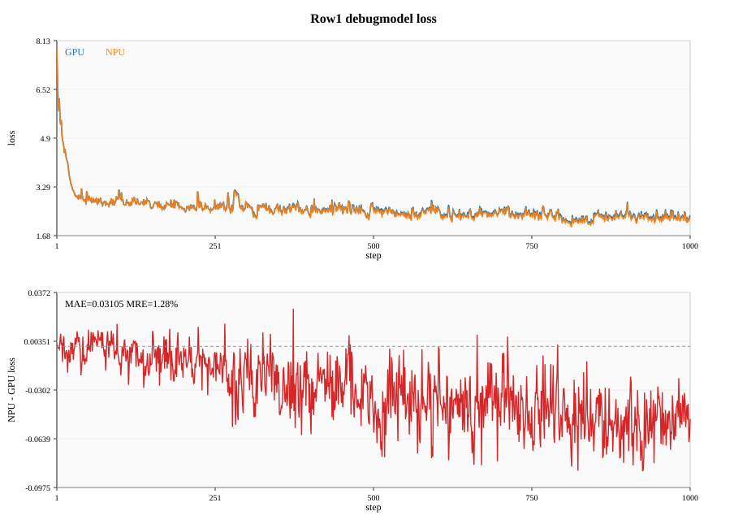
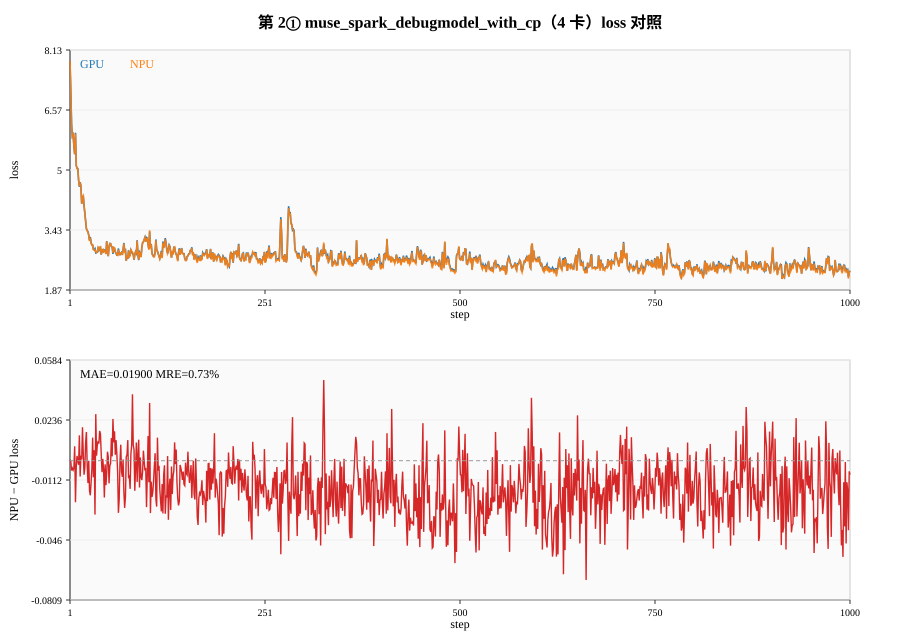
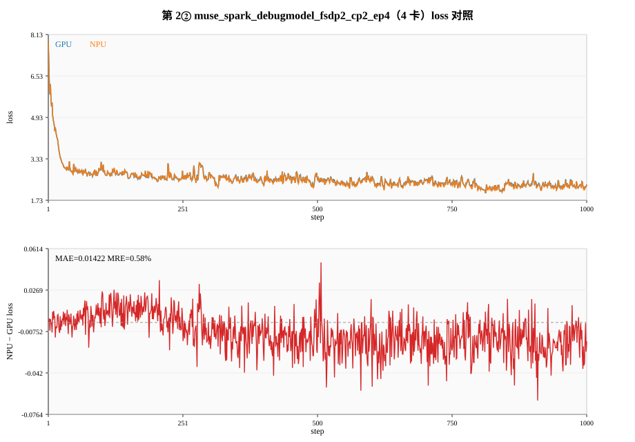
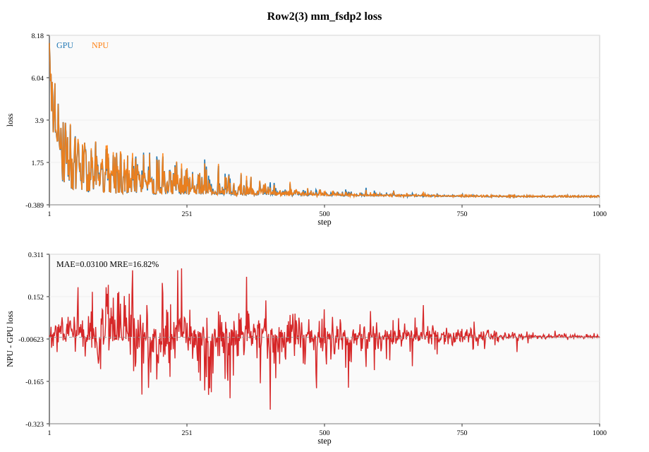
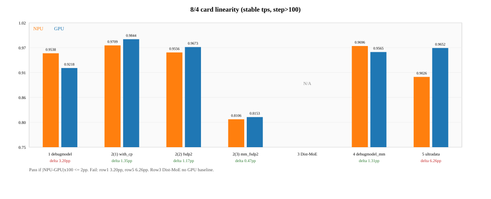

# Muse Spark（debugmodel）TorchTitan Ascend 训练验收报告（第 1–2 行）

> 按《模型验收报告模板》结构填写。验收口径以 Muse Spark 清单为准（MoE；性能比 **4↔8 卡只加倍 DP 的线性度**，不比绝对 tps；内存比日志 `memory` 预留）。  
> 数据与分析来自 `docs/npu_debugmodel_verification.md`、`docs/npu_gpu_acceptance_report.md`、`docs/gpu_baseline_perf_mem.md`、`docs/npu_baseline/`、`docs/gpu_baseline/`。  
> **本报告范围：清单第 1 行 + 第 2 行①②③。** 第 3–5 行不在此展开。

## 一、基本信息

| 项目 | 内容 |
|---|---|
| 模型名称 / 规格 | Muse Spark debugmodel（MoE，debug 尺度） |
| 模型类型 | MoE |
| 覆盖清单行 | 1：`muse_spark_debugmodel`；2① `with_cp`；2② `fsdp2_cp2_ep4`；2③ `mm_fsdp2_tp2_cp2_ep4` |
| 验收日期 | 2026-10-27～2026-11-02（精度 1000 步至 10-31；性能/内存补测至 11-02） |
| 代码分支 | `npu-muse-spark-debug-r04`（基于 `pytorch/torchtitan` `release/0.4`） |
| 文档成稿对照 HEAD | `fe36ba8a`（成稿时）；原始 GPU 基线导出 `7ed23db6` |

### 版本信息

| 软件 | 版本 / commit ID |
|---|---|
| CANN | 9.2.0（`/usr/local/Ascend/cann-9.2.0`） |
| PyTorch（NPU 容器） | `2.15.0+cpu` |
| Torch_Npu | `2.15.0.dev20261005+git14dc54e`（wheel 含 storage 等补丁） |
| Torchtitan | 分支 `npu-muse-spark-debug-r04` |
| Torchtitan_Ascend | 训练入口 `torchtitan_ascend.train`；Inductor / remat storage 走 ascend patches |
| Triton-Ascend | 3.6.0（随 CANN 扩展，无单独 `triton_ascend` 包） |

安装与补丁说明见仓库 `docs/npu_pta_fixes.md`、`docs/npu_910b_patches/`；环境总则 `docs/gpu_baseline_setup.md`。

### 环境信息

| 机器 | 角色 | 容器 / 节点 | 项目路径 |
| ---- | ---- | ---- | -------- |
| NPU | 910B4 ×8 | `179.173.2.3` / `npu-y00839695-torchtitan-20261028` | `/workspace/dev/torchtitan` |
| GPU | A100-80GB ×8 | `node-5-15` / `gpu-z00824525-tt` | 同分支 torchtitan |

密码不写入本报告。

---

## 总表（第 1–2 行）

| 清单行 | 配置 | 精度 | 性能 | 内存 | 确定性（NPU 自洽） |
| --- | --- | --- | --- | --- | --- |
| 1 | `muse_spark_debugmodel` 4 卡 `dp2×tp2×ep2` | **通过**（MRE 1.28%） | **不通过**（线性度差 3.20pp） | **通过** | **通过** |
| 2① | `with_cp` 4 卡 Ulysses | **通过**（MAE 0.019 / MRE 0.73%） | NPU 已测 0.9709，**待 GPU** | NPU 已测，**待 GPU** | **通过** |
| 2② | `fsdp2_cp2_ep4` 4 卡 AllGatherKV | **通过**（MAE 0.014 / MRE 0.58%） | NPU 已测 0.9556，**待 GPU** | NPU 已测，**待 GPU** | **通过** |
| 2③ | `mm_fsdp2_tp2_cp2_ep4` 8 卡 | **不通过**（MAE 0.031 / MRE 16.8%） | NPU 已测 0.8106，**待 GPU** | NPU 已测，**待 GPU** | **通过** |

说明：第 2 行性能/内存的「待 GPU」表示同 CONFIG 对照未齐，**不是**已测失败。GPU 必跑命令见 `docs/gpu_agent_perf_mem_todo.md`。

---

## 二、精度

### 2.1 验收方法

1. GPU / NPU 加载**同一份** step 0 权重（`outputs/checkpoint-<配置名>/`），各跑 ≥1000 步。
2. 数据、顺序、全局 batch、超参与确定性开关对齐；NPU 入口 `torchtitan_ascend.train`。
3. 对比逐步 training loss；MAE / MRE 按逐 step 误差再平均。`grad_norm` **不进**精度门槛，仅旁证。
4. 10 步各自随机初始化的对照**不是**本项（只作设备差量级参考）。

初始权重：仓库 `outputs/checkpoint-debugmodel|with_cp|fsdp2_cp2_ep4|mm_fsdp2_tp2_cp2_ep4/`  
曲线：`docs/gpu_baseline/*_1000.txt`、`docs/npu_baseline/*_1000.txt`  
MAE 摘要：`docs/npu_baseline/*_mae.txt`

### 2.2 验收标准（MoE）

满足任意一项即通过：

- 平均绝对误差（MAE）≤ 0.02，**或**
- 平均相对误差（MRE）≤ 2%

### 2.3 验收结果

| 对比场景 | 基线（GPU） | 待测（NPU） | steps | MAE | MRE | 结论 |
|---|---|---|---:|---:|---:|---|
| 第 1 行 debugmodel 4 卡 | `muse_spark_debugmodel` | 同配置 | 1000 | 0.03105 | **1.28%** | **通过**（靠 MRE） |
| 第 2① with_cp 4 卡 | `..._with_cp` | 同配置 | 1000 | **0.01900** | **0.73%** | **通过**（两条都过） |
| 第 2② fsdp2_cp2_ep4 4 卡 | `..._fsdp2_cp2_ep4` | 同配置 | 1000 | **0.01422** | **0.58%** | **通过**（两条都过） |
| 第 2③ mm_fsdp2… 8 卡 | `..._mm_fsdp2_tp2_cp2_ep4` | 同配置 | 1000 | 0.03100 | 16.82% | **不通过** |

#### 分窗口（loss）

| 行 | 1–100 MAE / MRE | 101–500 | 501–1000 | 全段 |
| --- | --- | --- | --- | --- |
| 1 | 0.00583 / 0.19% | 0.01995 / 0.77% | 0.04497 / 1.90% | 0.03105 / 1.28% |
| 2① | 0.00978 / 0.32% | 0.01945 / 0.71% | 0.02049 / 0.82% | 0.01900 / 0.73% |
| 2② | 0.00623 / 0.20% | 0.01235 / 0.47% | 0.01732 / 0.73% | 0.01422 / 0.58% |
| 2③ | 0.03596 / 2.73% | 0.04964 / 12.41% | 0.01510 / 23.17% | 0.03100 / 16.82% |

#### 分析要点（来自验证 / 验收文档）

**第 1 行**

- 第 1 步 loss：NPU 7.84031，GPU 7.84006，差 2.5e-4 → 权重加载成功，不是各自初始化。
- 第 1000 步：NPU 2.29888，GPU 2.34908；最大绝对差约 0.086（约第 925 步）。
- 全程 NPU loss 略低于 GPU，差随步数变大；后 500 步 MRE 1.90% 仍 ≤2%，全段靠相对误差过线。
- grad_norm 全段 MAE 0.045、MRE 7.56%，两条不过，**不改**精度判定。

**第 2①**

- MAE / MRE 双过；差比第 1 行更稳，后段相对误差仍 <1%。
- Ulysses CP + TP；配置清空融合 CUDA override，与 NPU 算子路径对齐。

**第 2②**

- 四行里精度最好（MAE 0.014）；AllGatherKV flex 路径。

**第 2③**

- debug 尺度多模态过拟合：两端 loss 都掉到 ~1e-3；相对误差被分母放大 → MRE 16.8% 失败。
- MAE 0.031 也超过 0.02。这组曲线**不能**填第 4 行 `debugmodel_mm`。
- 视觉长度变化触发 flex 重编译；GPU 上 `grid_sample` 反传曾走 CPU，loss/内存含该层差异。

### 2.4 统计图（loss 与误差）

蓝线 GPU，橙线 NPU；下图为 `NPU − GPU` 逐步差。









---

## 三、性能

### 3.1 验收方法（Muse Spark 口径）

与模板「纯 FSDP2 1/2/4/8」不同：清单要求**同一配置只加倍 DP**，用 8 卡稳定 tps / 4 卡稳定 tps 得线性度，再和 GPU 同一比值比。

1. 丢掉 step ≤100，对剩余 `tps` 算术平均（稳定段）。
2. 线性度 = mean_tps_8 / mean_tps_4。
3. 差值（百分点）= `|npu_ratio − gpu_ratio| × 100`。
4. **不比**绝对 tps（A100 约为 910B4 的 ~3 倍属硬件差）。

配置见 `muse_spark.py` / `tests/integration_tests/models.py` 中 `*_perf_dp*`。

### 3.2 验收标准

相同「只加倍 DP」条件下，NPU 与 GPU 线性度相差 ≤ **2 个百分点**。

### 3.3 验收结果

#### 第 1 行（已闭环）

| 端 | 4 卡 CONFIG / 稳定 tps | 8 卡 CONFIG / 稳定 tps | 线性度 | 与对端差 | 结论 |
| --- | --- | --- | --- | --- | --- |
| NPU | `perf_dp2` / 322.89 | `perf_dp4` / 307.98 | **0.9538** | 3.20pp | 见 GPU |
| GPU | `perf_dp2` / 1003.27 | `perf_dp4` / 924.81 | **0.9218** | 3.20pp | **不通过** |

- 掉吞吐越少越好：NPU 掉约 4.6%，GPU 掉约 7.8%。
- GPU 首轮 `perf_dp4_gpu.log` 疑似争卡作废；定稿用 `perf_dp4_gpu_r2.log`（趋势平稳）。分析仍建议独占时段可复测，但不能把不通过单归因成定稿跑挂。
- 日志：`logs/perf_dp2_npu_r2.log`、`perf_dp4_npu_r3.log`、`perf_dp2_gpu.log`、`perf_dp4_gpu_r2.log`。

#### 第 2 行（NPU 已测，待 GPU）

| 行 | 4 卡稳定 tps | 8 卡稳定 tps | NPU 线性度 | GPU | 结论 |
| --- | --- | --- | --- | --- | --- |
| 2① with_cp | 148.53 | 144.21 | **0.9709** | 待跑 | 待对照 |
| 2② fsdp2 | 121.64 | 116.24 | **0.9556** | 待跑 | 待对照 |
| 2③ mm_fsdp2 | 47.94 | 38.86 | **0.8106** | 待跑 | 待对照 |

2③ 视觉重编译会把部分步 tps 打到个位数；协议仍按 step>100 全平均。勿与第 1 行互除。



---

## 四、内存

### 4.1 验收方法

比训练日志 `memory`（该步窗口最大预留），**不用** `nvidia-smi` / `npu-smi` 整卡占用。  
先单卡同场景（全并行度 1、无 CP），再比 4 卡稳定步。丢掉第 1 步（常含编译）。

模板中的 `max_active` 本清单未单独采集；下表以 `memory`（reserved）为准。

### 4.2 验收标准

同场景单卡 / 多卡预留与 GPU **同量级对齐**（第 1 行已按双边数判定通过）。

### 4.3 验收结果

| 场景 | GPU memory (GiB) | NPU memory (GiB) | 结论 |
|---|---:|---:|---|
| 第 1 行单卡 `mem_1device`（step2–20） | 0.24 | 0.26 | **通过**（差 0.02） |
| 第 1 行 4 卡 `perf_dp2` 稳定段 | 0.11 | 0.11 | **通过** |
| 第 2① 单卡 / 4 卡 | 待 GPU | 0.25 / 0.10 | 待对照 |
| 第 2② 单卡 / 4 卡 | 待 GPU | 0.25 / 0.12 | 待对照 |
| 第 2③ 单卡 / 4 卡 | 待 GPU | 0.28 / 0.15 | 待对照 |

NPU 日志容量口径 Ascend910B4 约 29.49GiB。2③ 多模态 GPU 整卡占用与日志预留不是同一口径。

---

## 五、确定性

### 5.1 验收方法

```bash
export HCCL_DETERMINISTIC=true   # NPU
export MUSE_DEBUG_DETERMINISTIC=1
```

同配置连跑两次（通常 10 步），对比逐步 loss、grad_norm 打印值。

### 5.2 验收标准

- **本报告采用验证文档口径**：NPU 自洽两次逐项相同即通过。
- 验收总表另记「对 GPU」：跨设备打印值从第 1 步起不同 → 交叉项不通过（10 步差不发散，且与共享权重 1000 步不是同一实验）。

### 5.3 验收结果

| 卡数及策略 | steps | 结论（NPU 自洽） |
|---|---:|---|
| 第 1 行 4 卡 debugmodel | 10×2 | **通过** |
| 第 2① 4 卡 with_cp | 10×2 | **通过** |
| 第 2② 4 卡 fsdp2_cp2_ep4 | 10×2 | **通过** |
| 第 2③ 8 卡 mm_fsdp2… | 10×2 | **通过** |

补充：第 1 行两次 tps 可差一截（r1≈308，r2≈175），**tps 不作**确定性指标。跨设备 10 步 loss 差约 0.03～0.13 量级，与共享 step0 后第 1 步差 ~1e-4 不是同一件事。

---

## 六、问题记录

| 编号 | 问题描述 | 影响 | 解决方案 / 进展 | 状态 |
|---|---|---|---|---|
| P1 | 第 1 行性能线性度差 3.20pp > 2 | 性能项不通过 | 已用干净重跑；可独占复测 `perf_dp4`；NPU 扩展效率优于 GPU | 打开 |
| P2 | GPU 首轮 8 卡 `perf_dp4` 争卡退化 | 该日志作废 | 改用 `perf_dp4_gpu_r2.log` | 已关闭 |
| P3 | 第 2 行①②③ GPU 同 CONFIG 未跑 | 性能/内存不能闭环判定 | 见 `docs/gpu_agent_perf_mem_todo.md` | 打开 |
| P4 | 第 2③ 精度 MRE 16.8% / MAE 0.031 | 精度不通过 | debug 多模态过拟合 + 相对误差放大；勿填第 4 行；原因分析见 verification / acceptance 该配置小节；GPU 复验  | 打开 |
| P5 | 910B flex / Inductor / remat 需补丁与 ascend 入口 | 否则编译超时或段错误 | `docs/npu_910b_patches/` + torchtitan-ascend；`COMPILE_THREADS=1` | 已关闭（环境项） |
| P6 | NPU 8 卡首步 flex 超默认 300s watchdog | 训练失败 | `init/train_timeout_seconds=1800` 写入 perf 配置 | 已关闭 |

---

## 七、验证文档覆盖索引

| 主题 | 原文位置 |
| --- | --- |
| 字段含义（tps / memory / mfu 陷阱） | `npu_debugmodel_verification.md` 文首 |
| 第 1 行 10 步表、网格、本行四指标 | 同文档「第 1 行」 |
| 第 2 行①②③ 验证要点与数据 | 同文档「第 2 行」 |
| 精度窗口 / 性能线性度闭环 | `npu_gpu_acceptance_report.md` 第 1–2 行节 |
| 性能协议与 GPU 争卡说明 | `gpu_baseline_perf_mem.md`、`npu_gpu_row1_perf_mem_analysis.md` |
| GPU 待跑命令 | `gpu_agent_perf_mem_todo.md` |

---

## 附录：图表与原始数据路径

| 文件 | 说明 |
| --- | --- |
| `figs/row1_debugmodel_loss.svg` | 第 1 行 loss + 误差 |
| `figs/row2_1_with_cp_loss.svg` | 第 2① |
| `figs/row2_2_fsdp2_loss.svg` | 第 2② |
| `figs/row2_3_mm_fsdp2_loss.svg` | 第 2③ |
| `figs/row1_2_linearity.svg` | 线性度柱状图 |
| `muse_report_data/` | 本机缓存的 gpu_/npu_ 1000 步曲线与 mae |
| `make_charts.py` | 无 matplotlib 依赖的 SVG 生成脚本 |

报告作者：AI assistant（据仓库已提交数据整理，未编造 GPU 性能数）。

> 精度不通过原因分析见 `docs/npu_debugmodel_verification.md` 与 `docs/npu_gpu_acceptance_report.md` 对应配置小节；GPU 复验见 `docs/gpu_agent_precision_reverify_todo.md`。
